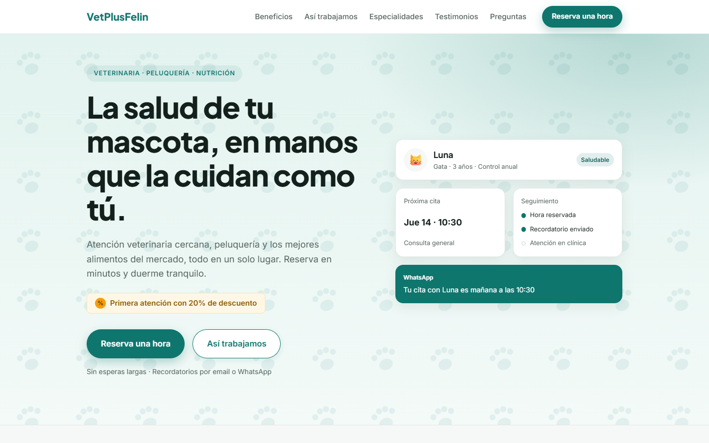
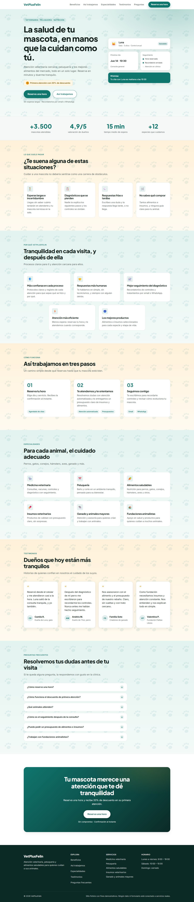
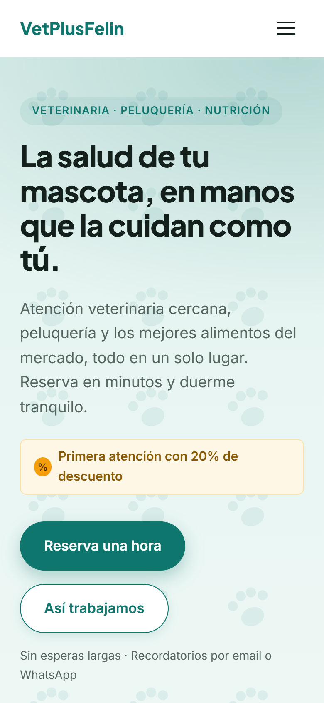
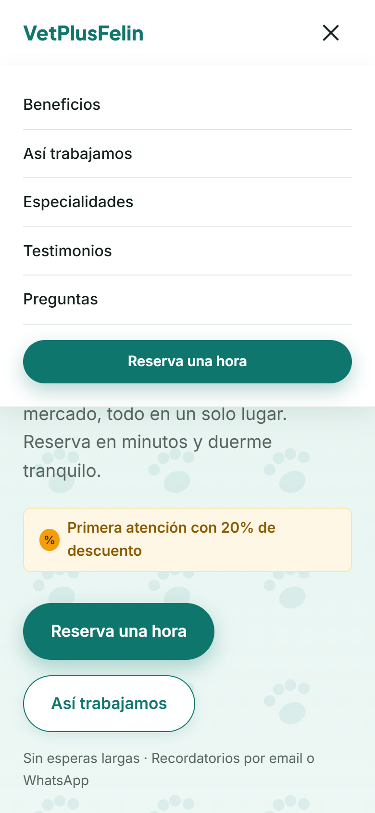

# VetPlusFelin – Landing page

Landing page moderna y orientada a conversión para **VetPlusFelin**, una clínica veterinaria que ofrece atención médica, peluquería y alimentos saludables para perros, gatos, conejos, hámsters, aves y ganado.

El objetivo de la página es que el visitante conozca los servicios y **reserve una hora**, con una oferta de bienvenida: **20% de descuento en la primera atención**.

> ## ⚠️ Aviso: proyecto ficticio
> **VetPlusFelin no existe.** Es un proyecto de demostración con fines de aprendizaje y portafolio.
>
> - La clínica, sus servicios, métricas, horarios, testimonios y nombres (incluida la "Fundación Patitas Libres") son **inventados**.
> - El sitio **no está conectado a ningún servicio**: "Reserva una hora", el seguimiento por email o WhatsApp y la atención automatizada son solo **visuales**, sin integraciones ni envío de datos.
> - No hay formularios que recojan información, ni teléfono, correo o dirección reales.

## Capturas

**Escritorio**



<details>
<summary>Ver la página completa</summary>



</details>

**Móvil**

| Hero | Menú móvil |
|---|---|
|  |  |

## Secciones

1. Cabecera con navegación y menú móvil
2. Hero: titular, subtítulo, CTA principal y secundaria, y visual tipo dashboard
3. Métricas de credibilidad
4. Problemas frecuentes del cliente
5. Beneficios principales
6. Cómo funciona, en tres pasos
7. Especialidades
8. Testimonios
9. Preguntas frecuentes (FAQ)
10. CTA final
11. Footer

## Cómo levantarlo en local

**Requisitos:** Node.js 20 o superior y npm.

```bash
npm install      # instala las dependencias
npm run dev      # servidor de desarrollo en http://localhost:5173
```

Otros comandos:

```bash
npm run build    # build de producción (carpeta dist/)
npm run preview  # sirve el build en http://localhost:4173
npm run lint     # ESLint
```

> Para medir rendimiento (por ejemplo con Lighthouse), usa `npm run build` y luego `npm run preview`. El servidor de desarrollo no es representativo.

## Stack

- [React](https://react.dev) 19
- [Vite](https://vite.dev) 8
- CSS plano con variables (sin frameworks de estilos)
- Fuentes autoalojadas con `@fontsource-variable` (Inter y Plus Jakarta Sans)
- ESLint

## Decisiones técnicas

**Arquitectura por responsabilidades (SOLID)**
- *Responsabilidad única:* cada sección es un componente en su propia carpeta (`src/sections/`), y cada pieza reutilizable hace una sola cosa (`Button`, `Card`, `Section`, `SectionHeader`, `Container`, `Reveal`).
- *Contenido separado de la UI:* todos los textos y cifras viven en `src/data/`. Cambiar el copy no exige tocar componentes.
- *Abierto a extensión, cerrado a modificación:* `CardGridSection` sirve a Problemas, Beneficios y Especialidades. `Section` admite distintos fondos con la prop `tone`. `Button` tiene variantes (`primary`, `secondary`, `light`) y tamaños.

**Estilos fáciles de retocar**
- `src/styles/tokens.css` concentra color, tipografía, espaciado, radios, sombras, ancho del contenedor, duraciones de movimiento y altura de cabecera. Se puede editar ahí, o en vivo desde DevTools sobre `:root`.
- Cada componente tiene su propio archivo CSS, junto al componente.
- Diseño *mobile-first*, con puntos de corte en `40rem`, `48rem`, `64rem` y `72rem`.

**Layout**
- CSS Grid con `subgrid` para que el contenido interno de las tarjetas (icono, título, texto) quede alineado entre tarjetas de una misma fila.
- Las filas incompletas de tarjetas se centran en lugar de quedar pegadas a un lado.

**Accesibilidad**
- HTML semántico (`header`, `main`, `footer`, `nav`, `section` con `aria-labelledby`, `dl`, `figure`).
- La FAQ usa `<details>`/`<summary>` nativos: accesibles por teclado y sin JavaScript.
- El menú móvil expone `aria-expanded` y `aria-controls`, y se cierra con la tecla Escape o al elegir un enlace.
- Contraste revisado y foco visible.
- Se respeta `prefers-reduced-motion`: se desactivan animaciones y scroll suave.

**Movimiento**
- Animación de entrada al hacer scroll con `IntersectionObserver` (hook `useReveal`), sin librerías.
- La animación del hero usa solo desplazamiento, sin opacidad, para no retrasar el LCP.
- Scroll suave con `scroll-padding-top` para que la cabecera fija no tape los títulos.

**Rendimiento y SEO**
- Fuentes servidas desde el propio sitio, sin CSS externo que bloquee el renderizado.
- `favicon.svg`, `robots.txt`, `<title>` y descripción, `theme-color` y metaetiquetas Open Graph.
- Resultado medido con Lighthouse 13 en móvil sobre el build de producción: **100 en Rendimiento, Accesibilidad, Buenas prácticas y SEO** (LCP 0,8 s, CLS 0,002). Los valores pueden variar según el entorno y el hosting.

## Estructura del proyecto

```
public/               # favicon.svg, robots.txt
docs/screenshots/     # capturas usadas en este README
src/
  main.jsx            # punto de entrada
  App.jsx             # composición de la página
  styles/             # tokens.css (variables), reset.css, base.css, index.css
  components/
    layout/           # Container, Section, Header
    ui/               # Button, Card, SectionHeader, Reveal
  sections/           # Hero, Metrics, Problems, Benefits, HowItWorks,
                      # Specialties, Testimonials, Faq, FinalCta, Footer
  hooks/              # useReveal
  data/               # hero.js, sections.js, closing.js, navigation.js
```

## Cómo personalizarlo

| Quiero cambiar… | Dónde |
|---|---|
| Colores, tipografía, espaciados, radios, duraciones | `src/styles/tokens.css` |
| Textos del hero, dashboard y métricas | `src/data/hero.js` |
| Problemas, beneficios, pasos, especialidades, testimonios, FAQ | `src/data/sections.js` |
| Menú de navegación | `src/data/navigation.js` |
| CTA final y footer | `src/data/closing.js` |
| Fondo de una sección | prop `tone` (`warm`, `mint`, `soft`) en la sección |
| Intensidad del patrón de huellas | `fill-opacity` de `--pattern-paw` en `tokens.css` |

## Pendientes si se publica

- Añadir `canonical` y `sitemap.xml` cuando exista la URL pública.
- Añadir una imagen para compartir (`og:image`).
- Sustituir los datos ficticios por contenido real, y conectar la reserva y el seguimiento a servicios reales, si el proyecto deja de ser una demostración.
